<div align="center">



<br/>

<a href="https://git.io/typing-svg">
  
</a>

<br/>

<a href="http://www.researcherweb.ir" target="_blank">
  
</a>
<a href="https://instagram.com/binary._.squad" target="_blank">
  
</a>


</div>

---

### ⚡ `yasin@srttu-ce:~$ cat about_me.cpp`

```cpp
#include <iostream>
#include <vector>
#include <string>

class YasinSheikhAbdi {
public:
    std::string name          = "Yasin Sheikh-Abdi";
    std::string major         = "Computer Engineering @ SRTTU";
    std::string codingJourney = "Beginner & Enthusiast in C++ and Python";
    std::string mentorship    = "English Instructor & Konkoor Advisor";
    
    // Communities & Projects
    std::string website       = "[https://www.researcherweb.ir](https://www.researcherweb.ir)";
    std::string team          = "Binary Squad (@binary._.squad)";

    // Off-Screen Passions
    std::vector<std::string> hobbies = { "Football ⚽", "Cycling 🚴‍♂️" };

    void dailyLoop() {
        while (true) {
            learnNewCode();
            teachAndMentor();
            rideAndPlay();
        }
    }
};
```

---

### 🛠️ `yasin@srttu-ce:~$ ls ./skills_and_fields`

<div align="center">

| 💻 **Programming** | 🎓 **Mentoring** | 🌐 **Web & Team** | ⚡ **Hobbies** |
| :---: | :---: | :---: | :---: |
|  |  | **[ResearcherWeb.ir](http://www.researcherweb.ir)** | **Football** ⚽ |
|  |  | **[Binary Squad](https://instagram.com/binary._.squad)** | **Cycling** 🚴‍♂️ |

</div>

---

### 📊 `yasin@srttu-ce:~$ htop --github-stats`

<div align="center">
  
  
</div>

---


